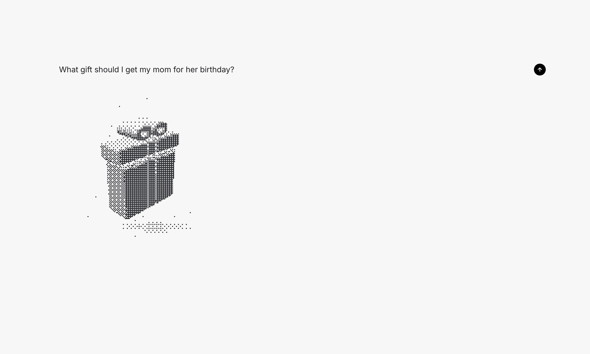

# Visual Agent Chat

A single-page agent chat. While the model works, a WebGL2 dithered "mind" tile morphs between shapes that match each step it narrates (searching, reading, calculating, running code), then the answer streams in.

- `index.html`: the whole app (HTML, CSS, GLSL shader, JS). No build step.
- Dithering core adapted from [Paper Shaders](https://shaders.paper.design/dithering) (Apache-2.0).

Note: the page calls the model and web search through the Claude Artifacts runtime (`window.claude`). Opened as a plain file it renders, but chatting only works when it is hosted as a Claude artifact.
